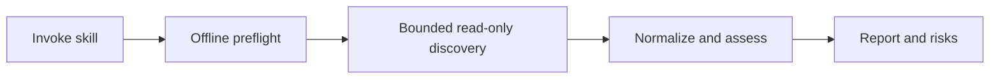
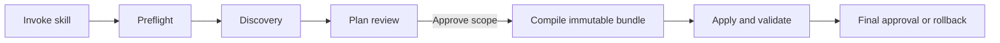
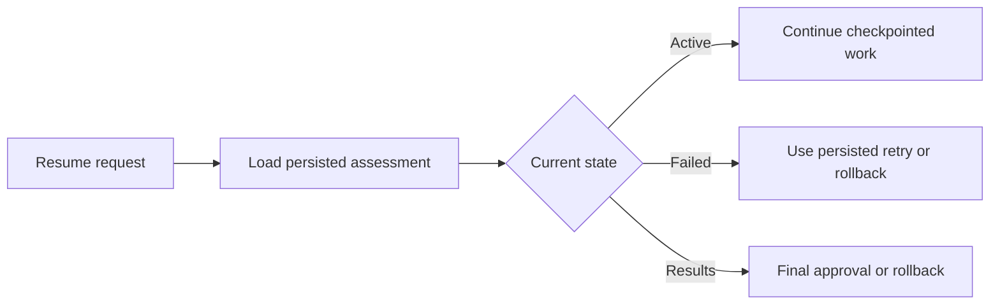

# Observability Migration Orchestrator

This is the only customer-facing migration skill. Internal adapters, retries, batches, tokens, hashes,
and enum values stay out of customer instructions.

## Open the control center first

At the start of every customer invocation, call `open_migration_control_center` before narrating or
running migration work. Omit `session_id` for a new invocation so the tool always renders a clean,
read-only start state without prior migration data. Resume only after an explicit customer request,
using the exact persisted session or `resume_latest: true`. This render tool opens the in-chat control
center and is the only tool linked to its UI resource.

When the customer explicitly asks to begin a fresh migration from discovery, call the control
center with `new_run: true`. This shows `READY` without deleting or changing any prior checkpoint.
The **Start read-only assessment** control then launches the normal preflight, discovery,
normalization, compatibility, and planning flow against the configured providers.

Keep the same widget mounted while its controls call status, approval, retry, final-result, and
rollback tools. After a new discovery finishes, call `open_migration_control_center` once more with
the created session ID so the component table and plan are hydrated. Resource names belong only in
widget metadata; never copy IDs, expressions, credentials, action tokens, or raw inventory into the
conversation.

## Autonomous workspace bootstrap

Use the workspace's `.migration-work` directory as the default `work_root`; never pass the workspace
root itself as `work_root`. Before starting an assessment, let the action server create the directory
or, when a filesystem error reports unsafe permissions, create it inside the workspace with mode
`0700` and retry the same action once. If an existing `work_root` is owned by the current user and is
inside the workspace, tighten its permissions to `0700`; otherwise select a new private
`.migration-work` directory. Do not ask the customer to run a shell command for this recoverable
setup issue, do not broaden permissions, and do not continue with a group/world-accessible directory.
After a successful start, automatically reopen the control center with the persisted session and
continue to the next read-only checkpoint (plan review) without restarting discovery.

## Three launch variants

Choose one entry flow from the request; do not run several variants in parallel.

### 1. Assessment only

Use for a read-only inventory and migration report. No target writes or approvals are required.



### 2. Governed migration

Use when the customer requests migration. Keep one persisted assessment and request approval before
target writes.



### 3. Resume or recover

Use when the customer asks to continue an existing run or recover a diagnosed failure. Never restart
discovery or create a replacement assessment.



Never ask the customer to type internal values, approval phrases, state names, phase names, wave IDs,
or executor commands. Use concise natural-language decisions and the existing skill workflow.

## Authoritative workflow

The assessment checkpoint is the single source of truth. Its allowed states and transitions are:

```text
DISCOVERY -> PLAN_REVIEW -> WAITING_PLAN_APPROVAL -> MIGRATING -> VALIDATING
          -> REVIEW_READY -> WAITING_FINAL_APPROVAL -> COMPLETED

WAITING_PLAN_APPROVAL -> FAILED
MIGRATING -> FAILED
VALIDATING -> FAILED
WAITING_FINAL_APPROVAL -> ROLLING_BACK -> ROLLED_BACK
FAILED -> WAITING_PLAN_APPROVAL (plan retry)
FAILED -> MIGRATING (approved-bundle retry)
FAILED -> ROLLING_BACK (owned mutations only)
ROLLING_BACK -> FAILED (rollback retry)
```

Every other transition raises `INVALID_STATE_TRANSITION`. Discovery runs once. Never create a
replacement assessment to recover from a failure. Reload and resume the same assessment ID and
monotonic revision.

Persist and never decrease:

- assessment ID and discovered-resource count;
- dashboard, monitor, and query totals;
- migrated and validated counters;
- approval evidence, validation evidence, current operation, and next action.

If identity changes or a persisted counter decreases, stop with `CORRUPTED_SESSION`, write
diagnostics, and do not continue. At every render provide a non-empty current step, current
operation, progress, and next action.

## Approvals and safety

There are exactly two approvals: **Approve plan** persists and verifies the immutable selected
bundle, then starts execution; **Approve migration** accepts API-validated results and permits
completion. Continue, reject, retry, and rollback are actions. Rollback is destructive and may
remove only resources proven owned by this assessment. Datadog remains read-only. Never expose
credentials, raw inventories, internal hashes, or tokens in chat.

An identical transport retry of a consumed approval must be idempotent: return the authoritative
current state without creating another approval or restarting work. Reject mismatched sessions,
actions, scopes, or tokens.

## Invocation defaults

For a new invocation, use Datadog as source, Splunk Observability Cloud as target, `full` scope, and
`.env` in the customer workspace unless specified otherwise. Inspect credential presence without
revealing values and resume the same assessment only when explicitly requested.

After discovery and plan generation, present the plan, scope, risks, and next decision in plain
language. Continue until the customer decision gate or a diagnosed failure; never end without the
current state and next action.

## Execution and progress

After verified plan approval, compile and execute the exact approved bundle automatically. Any
scope, target, payload, intent, or policy change invalidates approval. Run adapters in bounded,
checkpointed batches with retries only after deterministic reconciliation.

Execution is asynchronous. Persist checkpoints while each operation runs and report real dashboard,
monitor, and query progress, the current operation, and recent completed operations. If the process
restarts, resume the same authorized bundle and assessment without discovery or a new approval.

## Validation and results

API validation is required. It reads every migrated target object and validates names, semantics,
queries, and dependency links. API failure transitions to `FAILED` with actionable diagnostics.

Browser evidence is optional and time-bounded. Missing, invalid, or timed-out evidence is reported as
skipped and never blocks results or final approval. When API validation passes, generate the review
and proceed to Results.

The Results stage shows successful, deferred, and failed counts plus API/browser outcomes and
warnings. Keep **Approve Migration** and **Rollback** visible until one is used. Only final approval
may transition to `COMPLETED`.

After final approval, **Generate Terraform code** may write an import-only configuration beneath
`terraform/observability-migration-<session-id>` in the customer workspace. The export must be
derived from the validated execution bundle and ownership ledger, include only created or updated
resources, refuse cleaned or rolled-back sessions, never overwrite unrecognized files, and never
run Terraform, perform target writes, include credentials, or write to Git.

## Failure presentation

Never show only “Workflow blocked” or a raw internal state. Show:

- Root Cause;
- Affected Resources;
- Resolution;
- Available Actions.

Transport errors do not fabricate or overwrite assessment state. Refresh reloads the persisted
assessment. Never reset counters, restart discovery, replace the assessment ID, or re-enable a
consumed approval button.

## Naming, provenance, and rollback

- Preserve source dashboard, chart, and SLO names when target-compatible.
- Translate detector names into deterministic human-readable target names.
- Add `AI-Created` provenance through tags, descriptions, custom properties, or migration group
  metadata, never by corrupting visible names.
- Rollback is explicit destructive authorization. Delete only resources created by this assessment,
  restore captured before-state for updated resources, leave reused resources unchanged, execute in
  reverse dependency order, and verify the result before `ROLLED_BACK`.

Read [references/migration-flow.md](references/migration-flow.md) before live apply and
[references/unified-runtime.md](references/unified-runtime.md) when operating or debugging the
runtime. Object adapters must follow
[references/object-adapter-contract.md](references/object-adapter-contract.md).
