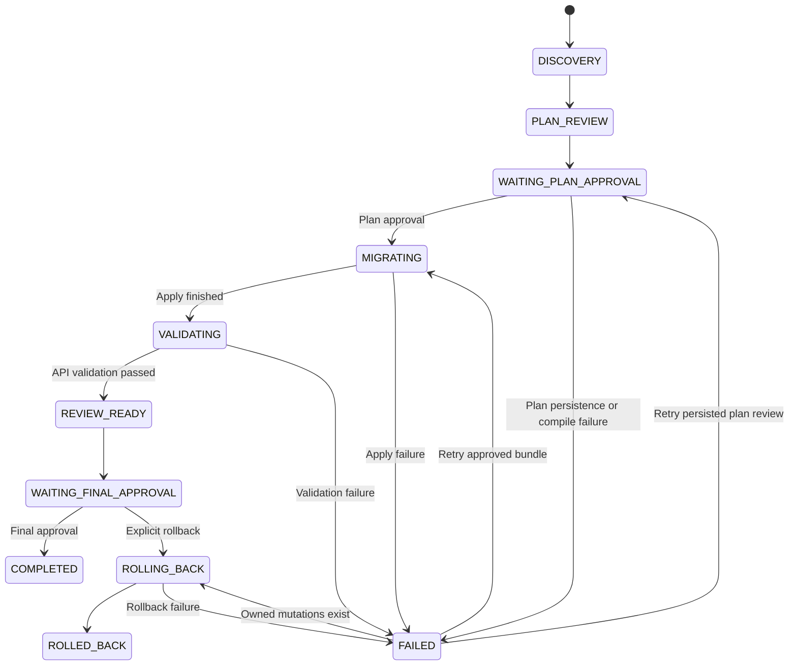
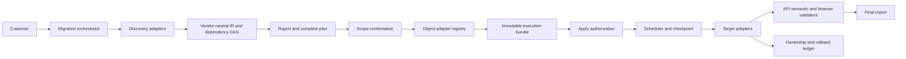

# Observability migration architecture

## Scope and status

The system is local and single-customer. Datadog is the implemented source; Splunk Observability
Cloud is the implemented write target. One customer-facing orchestrator coordinates read-only
discovery, planning, compilation, execution, API validation, browser validation, resume, and
rollback. Object-specific skills are internal adapters, not separate migration workflows.

The workflow contract, shared bundle and approval schemas, ownership ledger, dependency-aware
scheduler, bounded concurrency, safe retries, partial-failure continuation, adapter bridges,
detector naming normalization, dashboard geometry preservation, browser-evidence binding, and
owned-resource rollback are implemented. Legacy detector/SLO wave manifests remain private bridge
inputs rather than customer steps. Post-approval Terraform import configuration can be generated
locally from the validated ownership ledger; Terraform apply and Git publication are not implemented.

## Customer lifecycle



Only report review and apply authorization require customer confirmation.
Read preflight, adapter compilation, dry-run API checks, internal batching, retries, object-type
execution, read-back, browser checks, and final reporting do not.

## Components



- The orchestrator owns lifecycle, customer decision gates, target binding, cancellation, and reporting.
- Discovery adapters paginate all accessible object types and record permission gaps as evidence.
- The IR preserves intent, dependencies, dimensions, thresholds, windows, and source geometry.
- The plan includes every discovered object. Unsupported capability is data, not a hidden filter.
- Object adapters classify, plan, compile, validate, apply, and roll back one resource type.
- The scheduler orders the DAG and chooses bounded concurrency, rate limits, retries, and batches.
- The ownership ledger distinguishes `CREATED`, `UPDATED`, `REUSED`, and `NO_OP` resources.

## Authorization semantics

Scope confirmation binds discovery/report/plan hashes and the scope, naming, conflict, validation,
and rollback policies. Apply authorization binds the immutable bundle hash and authenticated target
organization. A payload-only bundle change invalidates apply authorization. A source intent, scope,
target, or policy change invalidates all prior confirmations.

The user's explicit migration request plus configured credentials permits bounded read-only
discovery for that run. The local read-authorization file remains an audit artifact but is not an
additional user interaction. Cost/billing data is read only when the request includes cost analysis.

## Naming and provenance

- Dashboard and SLO names preserve target-compatible source names.
- Detector names remove Datadog-only message placeholders and prefixes. For example,
  `Memory low for host {{host.name}}` becomes `Memory low by host`; the exact source name remains in
  the private mapping artifact.
- `AI-Created` is written to tags, custom properties, descriptions, or migration groups. It does not
  alter visible names merely to indicate provenance.
- Missing target metrics, unsupported formulas, or placeholder notes are `PARTIAL` or `UNSUPPORTED`,
  never counted as successful supported widgets.

## Validation

Compilation performs schema checks, deterministic translation tests, dependency checks, conflict
resolution, and non-mutating target payload validation. After apply, every object receives API
read-back plus semantic assertions against source intent. Every dashboard also receives browser
validation of title, component count, empty/error state, grid density, and source-relative layout.
Browser validation is evidence, not an approval.

## Rollback and cleanup

Each create is recorded as session-owned. Each update captures an encrypted/private before-state
reference before mutation. Reused resources are never owned. An explicit rollback request executes
reverse dependency order: dashboards, charts, groups, detectors, then SLOs for the currently
implemented target. It verifies deletion/restoration and can resume from a checkpoint.

## Extension contract

New source and target object types implement the contract in
`.agents/skills/observability-migration-orchestrator/references/object-adapter-contract.md` and emit
operations conforming to `schemas/execution-bundle.schema.json`. Adding an adapter must not create a
new customer approval. Required tests cover fixtures, conflicts, pagination, resume, validation, and
rollback.

## Local validation

```bash
PYTHONPYCACHEPREFIX=/tmp/cisco-innovation-pycache \
  python3 -m unittest discover -s tests -v
```

Live writes are never part of ordinary tests. Fake adapters exercise mutations and failure paths.
