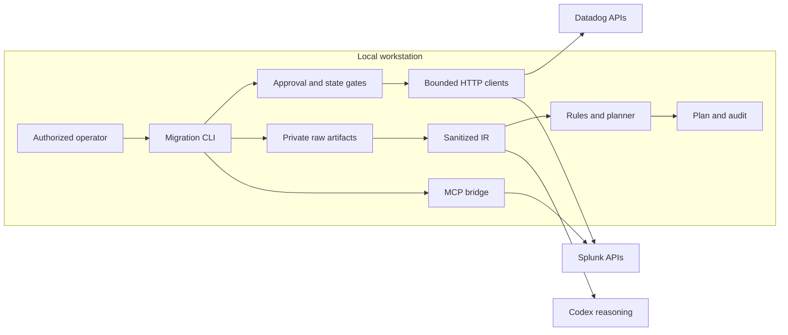

# Cisco Innovation observability migration threat model

## Executive summary

The highest-risk themes are credential exposure at vendor/network boundaries, untrusted customer configuration influencing decisions or target payloads, accidental use of credentials for the wrong Splunk organization, and local supply-chain/configuration execution in legacy MCP and shell tooling. Phase 1 reduces these risks with exact-origin read authorizations, no redirects, privacy-safe IR, declarative rules, private artifacts, and non-executable plans. Phase 2 adds separate create-only detector and SLO cores with environment-provided credentials, manifest and authorization binding, disabled notification-free payloads, wave caps, deterministic identities, and read-back validation. Residual risk remains because a same-user attacker can recompute local unkeyed hashes, private artifacts are not application-encrypted, and local audit is not externally immutable.

## Scope and assumptions

In scope are the migration cores and skills under `.agents/skills/`, the read-only reviewer definitions under `.codex/agents/`, `.mcp.json`, migration-relevant environment handling, synthetic/fake-adapter tests, and the local artifact boundary. Cluster deployment scripts and the OpenTelemetry demo runtime are out of scope except where shared configuration affects migration security. Bounded Splunk Observability Cloud detector and SLO POST paths now exist. Updates, enablement, browser automation, Terraform apply, and Git automation remain unavailable. A completed-session action can generate local import-only Terraform configuration from the validated bundle and ownership ledger; it performs no provider execution or network access and excludes credentials, reused resources, Terraform state, and Git writes.

Assumptions validated in the preceding architecture discussion:

- One customer and one authorized local operator use a session; multi-tenancy is out of scope.
- The app runs as a local CLI/Codex skill with no inbound public listener.
- Outbound access is limited to explicitly configured Datadog and Splunk HTTPS endpoints.
- Both Splunk targets may be selected, but each is enabled only when its environment access is configured.
- Raw configuration can contain secrets, PII, identifiers, and prompt-injection text; only sanitized IR may reach the LLM.

Open questions that could materially change ranking are whether workstations are shared or centrally backed up, whether enterprise TLS interception is present, and what retention/deletion requirements apply to raw inventories. A shared multi-user host would raise local artifact and approval-tampering risks.

## System model

### Primary components

- Phase 1 enters through `migration_assessment.py`; Phase 2 uses separate detector and SLO executor CLIs. Nine skills route workflows, while five project agents remain review-only.
- Safe config, read authorization, HTTP probing/collection, checkpointing, normalization, declarative rules, planning, and audit live under `.agents/skills/observability-migration-assessment/scripts/assessment_core/` and `collect_datadog_configuration.py`.
- Manifest validation, write authorization, detector adapter, execution checkpoint, validation, and audit live in the separate `observability-migration-executor/scripts/execution_core/`.
- SLO translation, manifest, authorization, adapter, checkpoint, validation, and audit live in `observability-migration-slo-executor/scripts/` with a distinct private namespace.
- Private session artifacts are stored under an operator-selected work root and excluded by `.gitignore`.
- Completed migrations can generate import-only Terraform files beneath the workspace from the
  validated execution bundle and ownership ledger. The generator never invokes Terraform or Git.
- MCP endpoints and a Splunk bridge are configured in `.mcp.json`; legacy lab scripts source environment files in `scripts/lib.sh` and `scripts/verify-mcp.sh`.
- Tests use only `tests/fixtures/datadog_inventory.synthetic.json` and standard-library mocks.

### Data flows and trust boundaries

- Operator environment → config parser: credentials and endpoints cross by local process environment/file; dotenv is parsed as data with shell expansion rejected (`assessment_core/config.py::parse_dotenv`).
- Customer/operator → approval gate: operation, target, categories, expiry, and exact origins cross as CLI arguments/local JSON; the record is schema checked and hash bound (`assessment_core/approval.py::validate_authorization`).
- Local process → Datadog/Splunk APIs: credentials cross over HTTPS; hosts/origins are validated, redirects disabled, requests bounded, and response bodies excluded from preflight output (`assessment_core/live_preflight.py::LiveProbeClient`).
- Vendor APIs → raw local store: untrusted configuration and possible PII cross over JSON/HTTPS; response size and type are bounded, then files are private (`collect_datadog_configuration.py`, `assessment_core/security.py::atomic_write`).
- Raw store → Codex/rule engine: only HMAC-pseudonymous allowlisted fields cross; forbidden keys and secret/PII patterns fail closed (`assessment_core/ir.py::build_inventory_ir`, `assessment_core/security.py::assert_codex_safe`).
- Rules/report → plan review: enum findings and hash-bound non-executable steps cross via JSON/Markdown; review approval binds both hashes and leaves execution false (`assessment_core/planner.py::build_plan_from_assessment`, `assessment_core/plan_approval.py`).
- Local manifest → execution authorization: restricted automatically assured or customer-reviewed detector payloads are sealed locally and bound to Phase 1 provenance, exact target origin and organization hash, refs, cap, operation, and expiry; no payload enters Codex or sanitized audit (`execution_core/manifest.py`, `execution_core/authorization.py`).
- Executor → Splunk detector API: exact-tag GET, non-mutating detector validation POST, bounded detector create POST, and ID GET are the only target operations; marker conflict or payload drift fails closed (`execution_core/adapter.py`, `execution_core/executor.py`).
- SLO executor → Splunk SLO API: exact-name search POST, non-creating validation POST, cap-one create POST, and ID GET are the only SLO operations; exact-name ambiguity, payload drift, enabled alerts, or notifications fail closed (`slo_adapter.py`, `slo_executor.py`).
- Local CLI → MCP bridge: vendor endpoints and a bearer-token argument cross through a spawned package; the package is installed by `npx -y` at a pinned version (`.mcp.json::mcpServers.splunk-platform`).
- Ownership ledger → Terraform export: validated target IDs and provider resource types cross into
  a private workspace directory; credentials, raw inventory, reused resources, and state files do
  not cross (`observability-migration-orchestrator/scripts/terraform_export.py`).

#### Diagram

## Assets and security objectives

| Asset | Why it matters | Security objective (C/I/A) |
|---|---|---|
| Datadog and Splunk credentials | Compromise enables customer-data access and potentially target changes outside this MVP | C, I |
| Raw source inventory | May contain PII, proprietary queries, identifiers, routing, and architecture metadata | C, I |
| Sanitized IR and reports | Drive migration decisions; poisoning can cause semantic or availability harm later | I, C |
| Authorization, plan-review, and execution records | Define permitted read scope, reviewed plan, and exact bounded create wave | I |
| Checkpoints and plan hashes | Control resume behavior and protect plan continuity | I, A |
| Audit log | Supports investigation and customer accountability | I, A |
| Trusted skill/core and compatibility rules | Determine what data is exposed and which actions are proposed | I |
| Local workstation and dependency toolchain | Holds credentials and executes provider/network code | C, I, A |

## Attacker model

### Capabilities

- A remote vendor/API-side attacker or compromised proxy may return malicious names, queries, oversized payloads, redirects, errors, or semantically deceptive data.
- A malicious or compromised repository/dependency can alter skill instructions, rules, shell scripts, MCP commands, or local package execution.
- A local same-user attacker can read or modify files available to that account and influence environment variables or CLI inputs.
- An operator may accidentally over-scope credentials, choose an unsafe endpoint, or expose the work root through backup/sync.

### Non-capabilities

- There is no public network service to attack directly in the MVP.
- An ordinary remote attacker is not assumed to control the operator account, local filesystem, or approved environment file.
- Cross-tenant access is not applicable because the validated deployment model is single-customer and local.
- Only approved migration mutations and session-owned cleanup are reachable against the target.
  Environment classification is intentionally not inferred; enablement, Terraform apply, browser
  mutation, and Git push are not reachable product capabilities. Terraform generation is a local
  filesystem-only action after final API validation and approval.

## Entry points and attack surfaces

| Surface | How reached | Trust boundary | Notes | Evidence (repo path / symbol) |
|---|---|---|---|---|
| CLI arguments and files | Local command invocation | Operator → core | Paths, session IDs, target, strategy, and confirmation flags | `.agents/skills/observability-migration-assessment/scripts/migration_assessment.py::build_parser` |
| Environment parser | `.env` or process environment | Operator config → core | New parser rejects expansion; legacy shell loaders execute content | `assessment_core/config.py::parse_dotenv`; `scripts/lib.sh::load_env` |
| Vendor HTTP responses | Approved outbound HTTPS | Vendor/network → core | Untrusted JSON, errors, and metadata | `assessment_core/live_preflight.py`; `collect_datadog_configuration.py` |
| Local inventory input | `prepare --inventory` | Filesystem → normalizer | May contain PII and injection strings | `assessment_core/ir.py::build_inventory_ir` |
| Compatibility rules | Local versioned JSON | Repository → planner | Strict keys/enums; no executable expression support | `assessment_core/rules.py::load_rules` |
| Checkpoint/approval artifacts | Resume and approval commands | Local store → state machine | Hash/schema checks but no keyed authenticity | `assessment_core/state.py::CheckpointStore`; `assessment_core/plan_approval.py` |
| MCP bridge | Codex/MCP startup | Repository config → package process | Dynamic package download and token in arguments | `.mcp.json::mcpServers.splunk-platform` |
| Audit destination | Every approved workflow event | Core → local file | Append-only for process, same user can alter/delete | `assessment_core/audit.py::append_audit_event` |
| Detector executor | Explicit local command after write approval | Operator → execution core → Splunk | Detector GET/POST only; restricted manifest remains local | `migration_execution.py`; `execution_core/adapter.py` |
| SLO executor | Explicit local command after separate write approval | Operator → SLO core → Splunk | SLO search/validate/create/read only; restricted manifest remains local | `slo_execution.py`; `slo_adapter.py` |
| Terraform export | Completed-session control-center button | Ownership ledger → workspace | Import-only files; exclusive creation, no provider execution, credentials, state, or Git writes | `terraform_export.py`; `apply_action_server.py::generate_terraform_code` |

## Top abuse paths

1. Credential theft: attacker changes a target URL or induces a redirect → client sends a token to an attacker host → attacker accesses customer systems. Exact-origin binding and no-redirect clients break the normal path, but proxy/DNS trust remains.
2. Prompt-driven data leak: malicious dashboard text instructs the LLM to reveal secrets → raw API text enters context → credentials or customer metadata are exposed. The allowlisted IR prevents raw names/expressions from crossing this boundary.
3. Plan poisoning: attacker modifies a local report or dry-run plan after customer review → resume accepts altered steps → a future executor acts on unreviewed scope. Current checkpoint and assessment/plan hashes detect ordinary edits, but a same-user attacker can recompute unkeyed hashes.
4. Shell configuration execution: attacker places command syntax in a legacy `.env` → operator runs a lab script → shell executes arbitrary local code with operator privileges.
5. Dependency compromise: attacker controls or compromises the default `mcp-remote@latest` resolution → `npx -y` installs and runs it → package reads token arguments/environment and exfiltrates credentials.
6. Artifact disclosure: raw inventory is written to a synced/shared path → backup or another local user obtains proprietary queries and PII → customer confidentiality is lost.
7. Resource exhaustion: vendor returns many pages or slow responses → collector consumes time/disk/API quota → discovery becomes unavailable or causes rate limiting. Preflight is tightly capped; full collector pagination still needs global quotas.
8. Audit erasure: malicious same-user process deletes or rewrites local JSONL/checkpoints → customer cannot reconstruct approvals and failures → accountability and incident response degrade.
9. Target confusion: an operator changes the realm or token between authorization and execution → detectors or SLOs could be sent to the wrong organization. Exact organization-ID hash binding stops execution when the authenticated target changes.
10. Ambiguous create response: the detector is created but the response is lost → naive retry creates a duplicate → duplicate SignalFlow jobs consume resources. The executor reconciles by deterministic exact tag and records a pending create without another POST when visibility is inconclusive.

## Threat model table

| Threat ID | Threat source | Prerequisites | Threat action | Impact | Impacted assets | Existing controls (evidence) | Gaps | Recommended mitigations | Detection ideas | Likelihood | Impact severity | Priority |
|---|---|---|---|---|---|---|---|---|---|---|---|---|
| TM-001 | Malicious endpoint, proxy, or API response | Attacker can influence configured endpoint, DNS/proxy, or redirect behavior | Redirect or reroute credential-bearing requests to an attacker | Credential theft and customer-system access | Credentials, raw data | Datadog allowlist, HTTPS validation, exact-origin approval, no redirects (`security.py::resolve_datadog_api_base`; `live_preflight.py`) | No certificate pinning; enterprise proxy policy unknown | Keep OS trust current, optionally support customer CA policy, log origin fingerprints without tokens, reject cross-origin collector pagination | Alert on origin mismatch, TLS failures, unexpected status changes | Low: endpoint and redirect controls remove common paths | High: tokens can expose customer systems | medium |
| TM-002 | Malicious customer object or API content | Attacker can create/alter source object text | Inject instructions or secret-like content into model-visible artifacts | Data disclosure or unsafe migration advice | Raw inventory, reports, trusted decisions | Strict pseudonymous allowlist and forbidden-field scan (`ir.py`; `security.py::assert_codex_safe`) | Pattern detection is not complete DLP; behavior flags still derive from untrusted text | Add schema validation and taint labels at every adapter boundary; fuzz redaction; keep raw values out of prompts permanently | Count and alert on rejected projections and unexpected fields | Medium: source content is routinely untrusted | High: could influence sensitive decisions | high |
| TM-003 | Malicious local environment file | Attacker can write a legacy env file and induce script execution | Place shell code in `.env` sourced by lab scripts | Local code execution and credential theft | Workstation, credentials, repository | New migration parser rejects shell expansion (`config.py::parse_dotenv`) | `scripts/lib.sh` and `scripts/verify-mcp.sh` still source env files | Migrate legacy scripts to the safe parser or require a trusted generated env format; document trust split | Log env file owner/mode and warn on unsafe ownership before legacy use | Medium on shared/dev workstations | High: executes as operator | high |
| TM-004 | Compromised npm package/registry | Operator starts configured MCP bridge with network access | Resolve and execute package; inspect token-bearing argv/environment | Credential exfiltration and local compromise | Credentials, workstation, toolchain | Pinned version variable and native MCP are available for other servers (`.mcp.json`; `.env.example`) | `npx -y`; bearer token in process args; no integrity lockfile | Pin exact integrity-verified version, preinstall from approved registry, avoid argv secrets, prefer native HTTP MCP/OAuth | Dependency inventory, lockfile diff checks, process/egress monitoring | Medium: package execution remains optional | High: code runs locally with secrets | high |
| TM-005 | Local user, sync client, or path attacker | Access to work-root parent, backups, or same account | Read artifacts or redirect writes with links | Raw configuration and PII disclosure | Raw inventory, approvals, reports | Private files, atomic writes, symlink checks, confirmed contained cleanup (`security.py`; `state.py::CheckpointStore.delete`) | No app encryption or backup controls; parent-directory race resistance is limited | Require approved encrypted work root, enforce retention, consider envelope encryption and directory-fd operations | File-mode audit, work-root location warnings, cleanup metrics | Medium: local sync/backup is common | High for sensitive inventories | high |
| TM-006 | Same-user local attacker or compromised process | Can modify session artifacts and code | Recompute unkeyed hashes or replace plan, manifest, approval, and checkpoint consistently | Unauthorized creation within token permissions | Approvals, checkpoints, plan and target integrity | Strict schemas, Phase 1 provenance binding, separate expiry/cap/origin/operation-bound write record, deterministic payload hashes (`execution_core/authorization.py`; `state.py`) | SHA-256 is integrity detection, not authenticity; Phase 2 now has a bounded write path | Require OS keychain-backed signatures or an external approval service if multi-user authorization is introduced | Verify signatures at every transition; alert on replay and cap changes | Low in the single trusted-user model | High within token scope | high |
| TM-007 | Vendor/API behavior or accidental huge account | Valid credentials and approved discovery | Return excessive pages, slow responses, or large objects | API rate limit, disk exhaustion, unavailable assessment | Availability, API quota, artifacts | Timeouts, per-response caps, bounded preflight (`live_preflight.py`; collector client) | No global object/page/byte budget across discovery | Add total request/object/byte/time quotas, cancellation, rate-limit backoff, and resumable page cursors | Metrics for requests, bytes, pages, duration, and 429s | Medium for large accounts | Medium: bounded to local workflow/API quota | medium |
| TM-008 | Same-user attacker or accidental cleanup | Local audit file is writable by operator account | Delete or edit audit/checkpoint history | Loss of evidence and non-repudiation | Audit and approvals | Append-only open flags for the process, private mode (`audit.py::append_audit_event`) | No tamper-evident chain, external retention, or separation of duties | Hash-chain events, periodically seal to customer-controlled immutable storage, define retention and deletion policy | Verify chain on resume; alert on gaps or truncation | Low in single trusted-user model | Medium for regulated evidence | low |
| TM-009 | Operator error or changed credentials | Realm or token identifies a different Splunk organization than the authorized wave | Run execution after changing `.env` | Creation in an unintended organization | Target integrity and quota | Exact `/v2/organization` ID/hash binding, optional `SPLUNK_O11Y_ORG_ID`, max-ten cap, disabled rules, no notifications, deterministic `MIGRATION-CODEX` markers, no update/delete | Disabled detectors still create jobs/resources | Show origin and organization hash before execution; keep one reviewed environment file per customer | Alert on migration markers and unexpected organization-hash changes | Low because runtime target binding is mandatory | Medium; operational impact is bounded | medium |
| TM-010 | Network/API failure | POST committed but response was lost | Retry create without reconciliation | Duplicate detectors, SLOs, or SignalFlow jobs | Target integrity and quota | Exact marker/name search before create; ambiguous absence records a pending create and stops without another POST; local locks serialize one workstation (`execution_core/executor.py`; `slo_executor.py`) | Executors on different workstations could still race | Add distributed idempotency support if vendor API provides it; operationally assign one executor host per wave | Alert on multiple exact identities; stop wave automatically | Low with single local operator | Medium | medium |
| TM-011 | Local path attacker or operator error | Can pre-create or replace the Terraform output path | Redirect or overwrite generated files, or trick the user into applying stale imports | Local integrity loss or unintended Terraform adoption | Workspace, target integrity | Workspace containment, symlink rejection, exclusive file creation, manifest hashes, completed-session/API-validation gate, created-or-updated-only ledger scope (`terraform_export.py`) | Same-user attackers can still replace the generator or recompute local hashes | Keep the workspace trusted, review generated code and plan, add signed artifacts if authorization crosses users | Verify export manifest before reuse; alert on unexpected files or scope changes | Low in the single-user model | Medium | medium |

## Criticality calibration

- Critical: a reachable path to broad destructive writes, remote unauthenticated local-code execution, or cross-customer credential/data compromise. Current detector and SLO paths are capped, disabled, notification-free, and create-only, so no current threat is rated critical.
- High: likely credential exfiltration, arbitrary code execution as the operator, or raw customer inventory disclosure. Examples: dynamic compromised MCP package execution; malicious `.env` sourced by shell; bypass of the IR boundary into the LLM.
- Medium: meaningful integrity/availability impact requiring endpoint, local, or same-user influence, with controls reducing exploitability. Examples: origin attack despite validation, checkpoint tampering before a future executor, unbounded discovery exhausting quota.
- Low: evidence loss or low-sensitivity leakage under unlikely local prerequisites and easy recovery. Examples: deletion of an unsealed local audit copy when another customer record exists; noisy failure of a synthetic-only test run.

## Focus paths for security review

| Path | Why it matters | Related Threat IDs |
|---|---|---|
| `.agents/skills/observability-migration-assessment/scripts/assessment_core/security.py` | Central origin, redaction, projection, and private-file controls | TM-001, TM-002, TM-005 |
| `.agents/skills/observability-migration-assessment/scripts/assessment_core/config.py` | Parses operator-controlled configuration and endpoints | TM-001, TM-003 |
| `.agents/skills/observability-migration-assessment/scripts/assessment_core/live_preflight.py` | Sends credentials across the network boundary | TM-001, TM-007 |
| `.agents/skills/observability-migration-assessment/scripts/collect_datadog_configuration.py` | Handles untrusted paginated API data and raw local storage | TM-002, TM-005, TM-007 |
| `.agents/skills/observability-migration-assessment/scripts/assessment_core/ir.py` | Enforces the raw-data to LLM trust boundary | TM-002 |
| `.agents/skills/observability-migration-assessment/scripts/assessment_core/approval.py` | Defines read operation, origin, category, and expiry authorization | TM-001, TM-006 |
| `.agents/skills/observability-migration-assessment/scripts/assessment_core/plan_approval.py` | Binds customer review to plan and assessment hashes | TM-006 |
| `.agents/skills/observability-migration-assessment/scripts/assessment_core/state.py` | Controls valid resume transitions and invariant checks | TM-006, TM-008 |
| `.agents/skills/observability-migration-assessment/scripts/assessment_core/audit.py` | Owns local evidence integrity and sanitization | TM-008 |
| `.agents/skills/observability-migration-executor/scripts/execution_core/manifest.py` | Owns restricted payload allowlist, disabled rules, markers, and payload hashes | TM-002, TM-006, TM-009 |
| `.agents/skills/observability-migration-executor/scripts/execution_core/authorization.py` | Defines exact wave scope, origin, organization hash, cap, expiry, and prohibited operations | TM-001, TM-006, TM-009 |
| `.agents/skills/observability-migration-executor/scripts/execution_core/adapter.py` | Sends the environment-provided Splunk token and exposes the only detector GET/POST methods | TM-001, TM-007, TM-010 |
| `.agents/skills/observability-migration-executor/scripts/execution_core/executor.py` | Enforces idempotency, conflict handling, checkpointing, and validation | TM-006, TM-009, TM-010 |
| `.agents/skills/observability-migration-slo-executor/scripts/slo_manifest.py` | Enforces the metric-SLO allowlist, disabled rule, source binding, and explicit differences | TM-002, TM-006, TM-009 |
| `.agents/skills/observability-migration-slo-executor/scripts/slo_adapter.py` | Restricts SLO network operations to search, validation, create, and read | TM-001, TM-007, TM-010 |
| `.agents/skills/observability-migration-slo-executor/scripts/slo_executor.py` | Enforces exact-name idempotency, pending intent, and read-back equivalence | TM-006, TM-009, TM-010 |
| `.mcp.json` | Executes a dynamic package with credential-bearing arguments | TM-004 |
| `.agents/skills/observability-migration-orchestrator/scripts/terraform_export.py` | Enforces completed-session provenance, safe output paths, no-secret import generation, and overwrite refusal | TM-005, TM-006, TM-011 |
| `scripts/lib.sh` | Sources operator environment as executable shell | TM-003 |
| `scripts/verify-mcp.sh` | Combines shell-sourced credentials and outbound network checks | TM-001, TM-003 |

Quality check: both Phase 1 and Phase 2 CLI/file/network/MCP entry points and trust boundaries are represented; runtime and legacy dev tooling are separated; the single-customer and conditional dual-target assessment scope is reflected; detector creation and organization binding are explicit; local Terraform generation is separated from unavailable Terraform apply and Git automation; workstation, TLS, and retention assumptions are listed.
